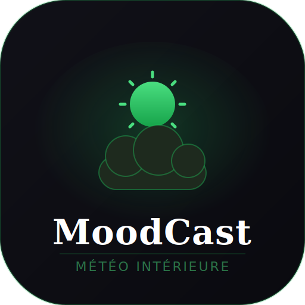

# 🌤️ MoodCast — Ta météo intérieure

> Application web progressive (PWA) de suivi quotidien du bien-être émotionnel et physique.

[**🔗 Voir la démo en ligne**](https://moodcast-meteo-interieure.netlify.app)



## 📖 Présentation

MoodCast permet de suivre son état au quotidien à travers trois jauges — **Corps**, **Mental** et **Humeur** — et traduit le score en une métaphore météo (du grand soleil à l'orage). L'application calcule des statistiques, affiche un calendrier de l'humeur sur 30 jours et propose un compagnon de bien-être propulsé par l'IA.

Projet personnel développé en **JavaScript vanilla**, sans framework, pour maîtriser les fondamentaux du web et les technologies PWA.

## ✨ Fonctionnalités

- **Suivi quotidien** via trois jauges interactives (1 à 10)
- **Météo dynamique** : le score global se traduit en icône et ambiance météo
- **Étiquettes d'émotion** (fatigué, motivé, stressé…) et note libre
- **Calendrier 30 jours** avec code couleur selon l'humeur
- **Statistiques** : score moyen, série de jours consécutifs, meilleur jour, graphique sur 7 jours
- **Compagnon IA** : conseils bienveillants personnalisés (API Claude d'Anthropic)
- **Rappel quotidien** configurable (heure personnalisable)
- **Mode hors-ligne** grâce au Service Worker
- **Installable** sur mobile et desktop (PWA)

## ♿ Accessibilité

L'accessibilité a été pensée dès la conception :

- Mode **contraste élevé**
- **Grand texte** (mise à l'échelle de la typographie)
- **Réduction des animations** (respecte aussi `prefers-reduced-motion`)
- Navigation **clavier** complète avec focus visible et lien d'évitement
- Attributs **ARIA** et labels pour les lecteurs d'écran
- Zones tactiles conformes (44–48px minimum)

## 🛠️ Technologies

- **HTML5** sémantique
- **CSS3** (variables, grid, flexbox, animations)
- **JavaScript ES6+** (vanilla, sans dépendance)
- **PWA** : Web App Manifest + Service Worker
- **localStorage** pour la persistance des données
- **API Claude** (Anthropic) pour le compagnon IA
- Déploiement : **Netlify**

## 📂 Structure du projet

```
moodcast/
├── index.html        # Structure de l'application
├── meteo.css         # Styles et thèmes (dont accessibilité)
├── meteo.js          # Logique applicative
├── sw.js             # Service Worker (hors-ligne + notifications)
├── manifest.json     # Manifeste PWA
├── icon-192.png      # Icône PWA
└── icon-512.png      # Icône PWA
```

## 🚀 Installation locale

```bash
# Cloner le dépôt
git clone https://github.com/TON-PSEUDO/moodcast.git
cd moodcast

# Lancer un serveur local (au choix)
python3 -m http.server 8000
# puis ouvrir http://localhost:8000
```

> Pour activer le compagnon IA, renseigner une clé API Anthropic dans `meteo.js`.
> ⚠️ En production, la clé doit être protégée côté serveur (fonction serverless) et non exposée dans le code client.

## 📱 Installation sur mobile

Ouvrir la [démo](https://moodcast-meteo-interieure.netlify.app) dans le navigateur, puis « Ajouter à l'écran d'accueil ».

## 🎯 Ce que ce projet démontre

- Conception d'une **application complète** de A à Z (UI, logique, persistance, déploiement)
- Maîtrise du **JavaScript natif** sans framework
- Intégration d'une **API d'IA** dans une application réelle
- Mise en place d'une **PWA** installable et fonctionnant hors-ligne
- Prise en compte sérieuse de l'**accessibilité** (WCAG)

## 📌 Améliorations prévues

- Sécurisation de la clé API via une fonction serverless Netlify
- Synchronisation multi-appareils
- Export des statistiques en PDF

---

Développé avec 🌿 par **[Ton Nom]** — projet de portfolio.
